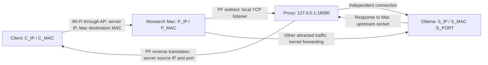

# M0 lab definition and feasibility record

Updated October 8, 2026. Status: offline M0 complete; transparent routing is **not demonstrated**. The user is currently away from the test network and lab assets; live routing proof is deferred to M6 until lab access. No PF, forwarding, or neighbor settings were changed during this investigation.

## Confirmed scope and remaining inputs

The first target is the Ollama native HTTP API. The client, research Mac, and server are on the same Wi-Fi network. The user reports the devices share a subnet and that client-to-server connectivity works directly; neither was independently verified from this Mac. Sharing an SSID does not establish that peers share an IPv4 broadcast domain or can exchange traffic: access-point isolation, VLAN assignment, and ARP protection remain live preflight gates.

The first synthetic adapter uses `POST /api/generate`, JSON requests, and JSON or incremental NDJSON responses. The default local base URL is `http://localhost:11434/api`; 11434 is Ollama's default/example only. Each session accepts the client IPv4, LLM server IPv4, and TCP port as configurable inputs; no specific lab address is needed to define this product contract. Live validation needs the selected addresses and port. Ollama streams NDJSON by default, with `stream:false` requesting one JSON response. Sources: [Ollama introduction](https://docs.ollama.com/api/introduction), [generate endpoint](https://docs.ollama.com/api/generate), and [streaming](https://docs.ollama.com/api/streaming).

HTTP/1.1 is the selected initial transport, subject to confirming the actual client. The model name in synthetic fixtures need not correspond to an installed model. The eventual client may use `/api/chat`; confirm its path before building an adapter around `/api/generate` alone.

| Lab field | Current value |
| --- | --- |
| Client application, OS, IPv4/MAC | Unconfirmed |
| Ollama version, server OS, IPv4/MAC | Unconfirmed |
| Model and actual endpoint paths | Unconfirmed |
| Research interface and IPv4/MAC | Unconfirmed; do not assume `en0` |
| Shared IPv4 subnet | User-reported; live link/ARP verification pending |
| AP isolation/ARP policy | Unverified |
| Server LAN listener and firewall reachability | Client reachability user-reported; verify research Mac reachability |
| Investigation host | macOS 27.0.1, build 26A434, arm64; not a declaration of supported minimum OS |

Ollama defaults to a loopback listener, so preflight must verify the server is configured to accept the selected LAN interface and that its firewall allows the lab peers. See [Ollama FAQ](https://docs.ollama.com/faq).

Synthetic request and JSON/NDJSON response fixtures are in [`tests/fixtures/m0/`](../tests/fixtures/m0/README.md). They contain documentation-only addresses and a placeholder model, with no captured user traffic.

## Topology and traffic matrix



`C_IP` and `S_IP` are session-configured IPv4 addresses; `P_IP` comes from the selected research interface. All three must be distinct and confirmed before activation. `S_PORT` is the session-configured server TCP port (1–65535), with 11434 offered only as the Ollama default. The AP carries all Wi-Fi frames; the arrows describe logical delivery, not a direct radio link. Bidirectional ARP redirection is required for the initial bypass-flow experiment, while the independent proxy upstream connection already returns to the Mac.

| Traffic/network | Initial behavior | Evidence still needed |
| --- | --- | --- |
| IPv4 HTTP/1.1 POST `/api/generate`, JSON | Inspect; edit in a later milestone | Actual client protocol/path |
| Ollama NDJSON or single JSON response | Forward incrementally / preserve body | Socket relay and eventual live streaming |
| Other HTTP paths on session-configured server TCP port | Relay without retaining body | M2 protocol tests |
| Other IPv4 ports attracted by ARP | Kernel bypass forwarding, no inspection | Both-direction live routing |
| HTTPS / TLS | No inspection or editing; bypass for other ports | Actual port inventory |
| TLS or unsupported protocol on configured HTTP port | Reject explicitly; require correct configuration | M2 policy/tests |
| IPv6, HTTP/2, HTTP/3, WebSockets | Outside initial interception scope | Preflight detection and explicit exclusion |
| Compressed/signed/multipart request bodies | No editing | M2/M4 supported framing policy |
| Existing TCP connections | Client reconnect required | Live transition behavior |
| Isolated Wi-Fi, static neighbors, ARP protection | Unsupported if redirection cannot be proven | AP/network preflight |
| Routed peers or different VLANs | Unsupported initial topology | Prefix and next-hop verification |

## PF integration decision

Use the session-configured `S_IP:S_PORT` for upstream routing and connectivity preflight; use configured `C_IP` for client restrictions. Session configuration includes the research interface, client IPv4, LLM IPv4, LLM TCP port (1–65535), and API paths. Validate addresses as usable unicast IPv4 peers and validate the port range before activation. Freeze one immutable configuration snapshot for the active session; derive both PF source/destination matching and proxy upstream routing from that snapshot. Reject configuration mismatches or failed endpoint validation rather than choosing another destination. The GUI exposes these inputs and diagnostics display the selected destination. Ignore HTTP `Host` for routing purposes; the single-target proxy does not need privileged original-destination lookup. This preserves a narrow upstream boundary and avoids redirecting traffic to an arbitrary header-selected destination.

The installed `pf.conf(5)` documents external-interface `rdr` to `127.0.0.1` and reverse translation using connection state. The rule must match incoming interface, client source, server destination, IPv4, TCP, and destination port. Locally originated proxy upstream traffic cannot match that incoming client rule.

A **conceptual**, unattached anchor rule is:

```pf
# Replace only after validating actual lab addresses and interface.
rdr on LAB_IF inet proto tcp from C_IP to S_IP port S_PORT -> 127.0.0.1 port 18080
pass in quick on LAB_IF inet proto tcp from C_IP to 127.0.0.1 port 18080 flags S/SA keep state
```

This text is not executable PF syntax until placeholders are replaced. The filter sees the translated destination. Restrict the listener's accepted peer to the configured client as an additional application check. Do not use `rdr pass`: the installed manual states that it bypasses filter-rule inspection.

**Anchor attachment is unresolved.** Loading `local_llm/session` will not work unless an active `rdr-anchor` and filter `anchor` reference evaluate it. The stock on-disk macOS rules contain `com.apple/*` entry points, not an application entry point. Do not appropriate Apple's namespace or replace the global active ruleset. An operator-provisioned dedicated attachment point is the provisional lab strategy; installation/signing and runtime coexistence require validation in M6.

Read-only policy inspection and parse-only validation belong in preflight. The installed `pfctl(8)` documents `-n` for parsing without loading, `-E` for an enable reference, and `-X token` for releasing that reference. On-disk configuration is not proof of runtime attachment. Active anchors, skip rules, earlier quick rules, translation/filter counters, and target-specific state must be examined in the disposable lab.

Syntax-only check on the investigation host: `/sbin/pfctl -n -f /tmp/local-llm-m0-syntax.pf` exited 0 for the two rules above with `en0` and documentation addresses `192.0.2.10` / `192.0.2.30`. The tool emitted its generic `-f` global-rules warning; `-n` prevented loading. This proves parser acceptance only, not interface suitability, active anchor evaluation, or packet behavior. The temporary sample was never applied.

## Ownership, startup, rollback, and shutdown

The unprivileged GUI owns configuration and presentation. A narrowly authenticated helper validates the selected interface/addresses, opens BPF/capture/injection resources, owns PF changes and settings, and runs a watchdog. A manually launched disposable lab helper is sufficient for the feasibility experiment; production helper signing/installation is unresolved.

1. Validate session-configured client/server IPv4 addresses and server port, verify reachability to that exact server endpoint and protocol, reject unsupported topology, and record actual neighbors.
2. Start listener and establish its ability to reach the selected mock server.
3. Snapshot only forwarding/ICMP-redirect settings that the helper intends to change; record old and applied values.
4. Acquire and journal the helper's PF enable reference; verify dedicated anchor attachment, then install session rules. Prepare scoped bypass policy and forwarding.
5. Start helper heartbeat recovery, then activate ARP redirection. Require a new client connection.
6. Mark healthy only after frame arrival, PF match, local acceptance, upstream delivery, and translated downstream reply all have independent evidence.

Rollback runs in reverse ownership order if any step fails. Release only the acquired PF token. Remove only the session's rules and demonstrably owned state; never flush global rules or state. Restore a global setting only if its current value still equals the value applied by this helper, and report conflicts instead of overwriting concurrent changes. Serialize application sessions; equality alone cannot identify an unrelated owner that applied the same setting.

For normal stop, quiesce client activity and drain or explicitly terminate proxy connections before restoring direct neighbors. Cease ARP refresh, attempt corrective neighbor updates, remove owned translation/state, conditionally restore settings, and release the token. A proxy crash loses its TCP streams; watchdog cleanup restores future connectivity, not the interrupted streams. AP behavior and stale neighbor caches can prevent immediate restoration.

## M6 disposable lab proof and evidence log

Use synthetic payloads and a mock endpoint before sending an LLM prompt. A local loopback relay can prove byte transport; it cannot prove delivery of a foreign destination IP, PF interception, Wi-Fi ARP changes, or reverse translation.

Record each row as PASS/FAIL with exact setup, timestamps, and sanitized evidence. No live row has a PASS yet.

| Gate | Required observation |
| --- | --- |
| Baseline | Client reaches mock server directly; two distinct server ports work |
| MAC/IP mismatch | Capture shows destination Mac MAC and unchanged server IP |
| Local acceptance | Fresh SYN produces a listener acceptance plus scoped PF state/counter |
| Original destination | Proxy dials exactly session-configured S_IP:S_PORT, including a nondefault-port case |
| Loop avoidance | Server sees a distinct Mac-source connection; no recursive listener accepts |
| Reverse translation | Client sees server source IP/port on SYN-ACK and HTTP response |
| Streaming | NDJSON first fragment arrives before final fragment |
| Body lengths | Shorter/longer JSON modifications arrive intact and exactly once at the mock server through the real network path |
| Bypass | Second port succeeds both ways without body retention |
| Partial failure | Listener absent/upstream refusal/install failure rolls back owned changes |
| Recovery | Repeated stop/start, proxy loss, interface loss, stale neighbors measured |
| Coexistence | Unrelated PF rules, state, and enable references survive cleanup |

M0 covers offline design, configuration, topology/matrix, documentation research, synthetic fixtures, and parse-only checks. Implementation, testing, and review each voted COMPLETE on this revised offline scope. All live inventory and routing evidence above belongs to M6 and does not block M0–M5. Do not infer live feasibility from documentation, fixture validation, or a loopback test.
